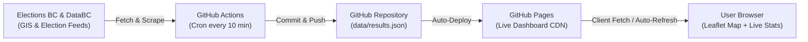

# British Columbia Provincial Election Results Dashboard 🗳️🍁

A cloud-native, real-time web dashboard to monitor and analyze the **British Columbia Provincial General Election**. 

This system runs **100% in the cloud** with zero server infrastructure costs:
* **Storage & Version Control:** GitHub Repository
* **Interactive Frontend Hosting:** GitHub Pages
* **Automated Data Feed Updates:** GitHub Actions cron jobs running periodically throughout election night
* **Electoral District Geospatial Map:** Official 2023/2024 redistribution boundaries from Elections BC and the BC Geographic Data Warehouse

---

## 🚀 Live Demo

* **Web Dashboard:** [https://J7892.github.io/bcresults/](https://J7892.github.io/bcresults/)
* **Repository:** [https://github.com/J7892/bcresults](https://github.com/J7892/bcresults)

---

## ✨ Features

- **Interactive GIS Map:**
  - Built with Leaflet.js with high-contrast, dark-mode vector cartography.
  - Features all 93 provincial electoral districts updated to the 2023 redistribution boundaries.
  - Color-coded choropleth representation: BC NDP (Orange), BC Conservative (Blue), BC Green (Green).
  - Dynamic hover highlighting and rich tooltips showing candidate names, margins, and vote shares.
  - Regional focus presets for rapid zoom into high-density battlegrounds: **Metro Vancouver**, **Greater Victoria**, **Interior / Okanagan**, and **Northern BC**.

- **Majority Tracker Bar:**
  - Visual 93-seat bar indicating majority threshold (47 seats needed to form government).
  - Real-time seat counts for elected candidates and leading ridings.

- **Deep Riding Inspector (Drawer):**
  - Click on any electoral district to open a side drawer detailing:
    - Elected/leading candidate and party
    - Candidate vote totals, percentages, and progress bars
    - Victory margin in votes and percentage
    - Historical shift vs. 2020 election (holds vs. flips)
    - Voter turnout and total valid ballots cast

- **Battleground Races Tracker:**
  - Dedicated view filtering razor-thin ridings decided by less than 3.5% of total votes.
  - Head-to-head vote margins and progress bars for the top two candidates.

- **Seat Flips & Pickups Table:**
  - Comprehensive list of ridings that flipped allegiance between parties.

- **All 93 Ridings Table:**
  - Sortable, searchable table across candidate name, riding name, margin, turnout, and vote count.
  - Party filters for targeted analysis.

- **Disproportionality & Vote Share Analysis:**
  - Comparison charts showing popular vote percentage versus seat share in the legislature.

---

## ☁️ Cloud Architecture & Automated Pipeline



1. **Automated Cron Updates (`.github/workflows/update_results.yml`):**
   - Runs every 10 minutes (or on manual trigger via `workflow_dispatch`).
   - Executes `scripts/update_results.py` in a Python 3.11 runner.
   - Detects changes in vote counts or reporting ridings.
   - If new results are found, commits `data/results.json` directly back to `main` with `[skip ci]`.

2. **Custom Feed Support:**
   - You can pass a custom results URL or live JSON endpoint by setting the `RESULTS_URL` environment variable or triggering the GitHub Actions workflow with the `results_url` input parameter.

---

## 🗺️ Geospatial Data Pipeline

The electoral boundaries are sourced directly from Elections BC's spatial catalogue:
* **Elections BC GIS Spatial Data:** [https://elections.bc.ca/resources/maps/gis-spatial-data/](https://elections.bc.ca/resources/maps/gis-spatial-data/)
* **BC Data Catalogue Dataset:** [Provincial Electoral Districts - Redistribution 2023](https://catalogue.data.gov.bc.ca/dataset/1cba4b16-263f-4d42-8d84-f5fecaa03d1a)
* **BC Geographic Data Warehouse WFS:** `WHSE_ADMIN_BOUNDARIES.EBC_ELECTORAL_DISTS_BS11_SVW`

To re-download and optimize the shapefile geometries:
```bash
python3 scripts/download_shapefile.py
```
This simplifies the raw 22MB geometry into a clean ~950KB GeoJSON (`data/bc_districts.geojson`) with 4-decimal precision, ensuring fast loading on mobile and desktop web browsers without visual degradation.

---

## 💻 Local Development

To run the dashboard locally:

1. Clone the repository:
   ```bash
   git clone https://github.com/J7892/bcresults.git
   cd bcresults
   ```

2. (Optional) Run the update script to fetch the latest election data:
   ```bash
   python3 scripts/update_results.py
   ```

3. Start a local HTTP server:
   ```bash
   python3 -m http.server 8000
   ```

4. Open your browser at [http://localhost:8000](http://localhost:8000).

---

## 📄 License & Data Attribution

- Electoral district boundary data licensed under the **Open Government Licence – British Columbia** (Province of British Columbia / Elections BC).
- Results data provided for civic monitoring and journalistic transparency.
